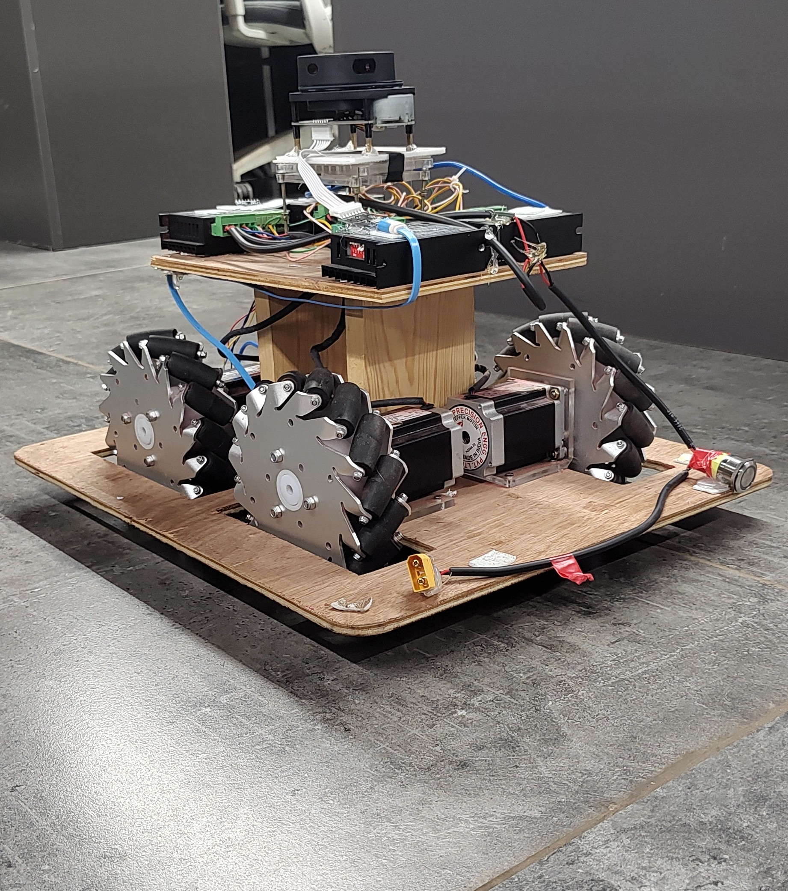
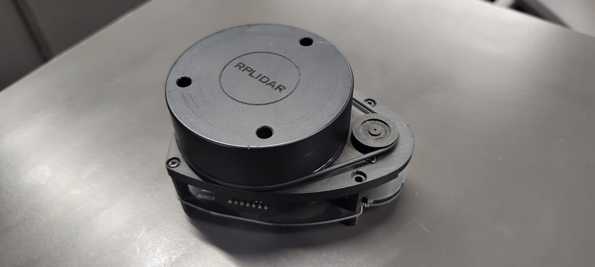
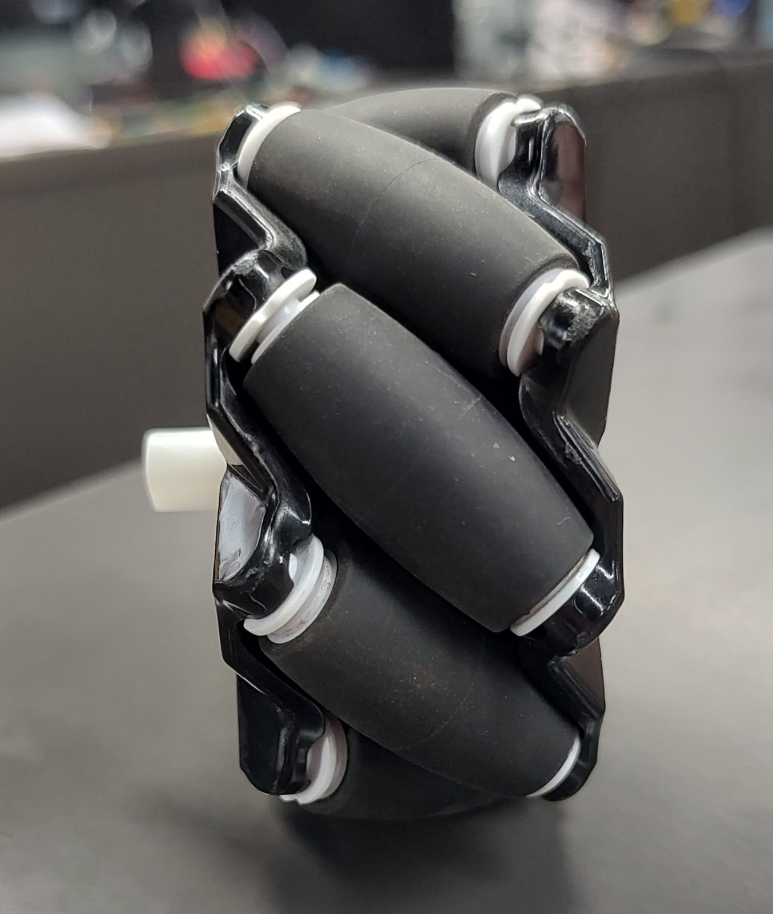
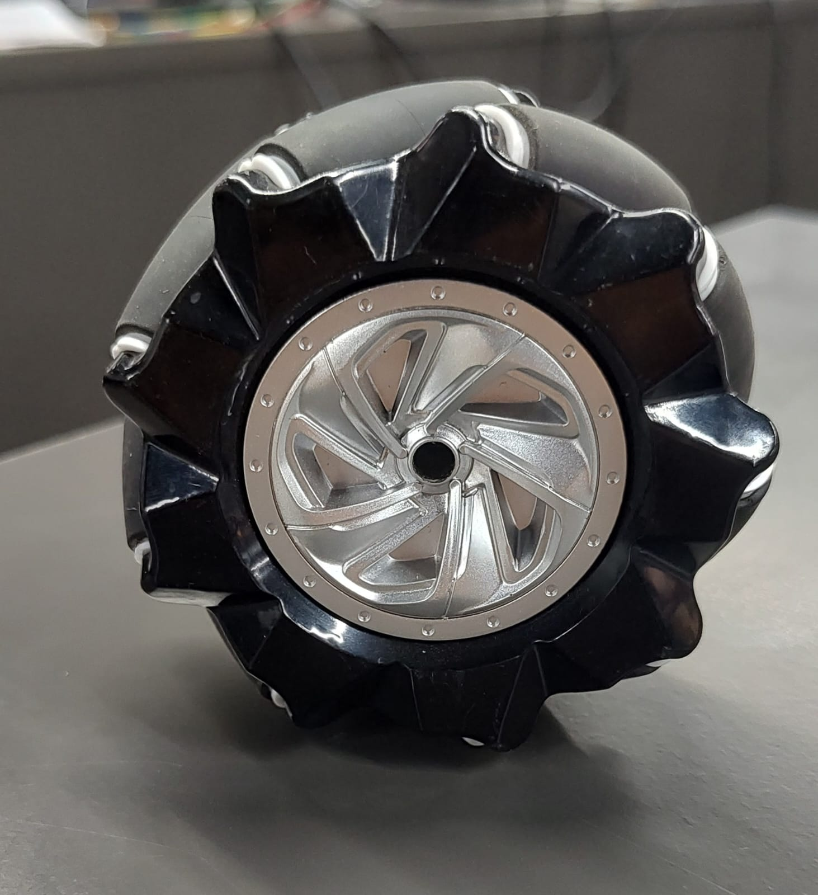
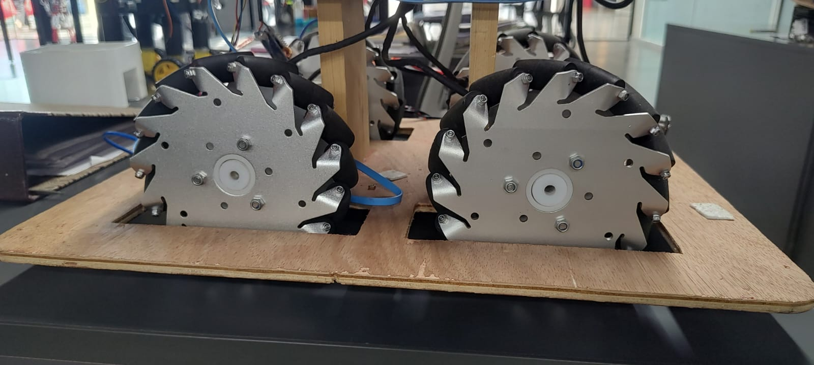

# Surveillance Holonomic Robot

<p align="center">
  
</p>

<p align="center">
  <b>Omnidirectional Mecanum platform</b> · dual-controller ROS stack · LiDAR SLAM & surveillance
</p>

<p align="center">
  <a href="#citation"></a>
  
  
  
  
</p>

Open-source software and hardware artifacts for a **cost-effective holonomic surveillance robot** with Mecanum wheels, RPLiDAR-based mapping, and a dual-controller architecture (NVIDIA Jetson Nano + Arduino Mega).

> **Publication:** *Design and Development of Surveillance Holonomic Robot* — accepted in the **International Journal of Information Technology (IJIT), Springer**.  
> Manuscripts and internal research PDFs are **not** published in this repository (see [Confidential materials](#confidential-materials)).

> **Research prototype:** This repository is **lab research / academic prototype code** from the AI & Robotics Lab (Woxsen University), released to accompany the paper. It is **not** production or industry-grade robot software. Expect experimental scripts, hardcoded ports/IPs, and incomplete stubs alongside the working dual-controller bring-up path.

---

## Demo

[](https://youtu.be/Kkh1Xvi68JU)

**[▶ Watch on YouTube](https://youtu.be/Kkh1Xvi68JU)** — unlisted demo of the Mecanum + LiDAR surveillance robot.

---

## Highlights

- **Holonomic locomotion** — four Mecanum wheels for instantaneous \(V_x\), \(V_y\), \(\omega_z\) motion in confined spaces  
- **Dual-controller architecture** — Jetson Nano (ROS, SLAM, vision) + Arduino Mega (stepper `cmd_vel` execution)  
- **LiDAR-centric perception** — RPLiDAR A1 for real-time mapping, obstacle awareness, and navigation  
- **IMU fusion** — MPU6050 orientation support for odometry / EKF-style fusion nodes  
- **Remote / IoT hooks** — MQTT bridge for teleoperation and marker-driven goals  
- **Simulation + hardware** — URDF/Gazebo worlds, RViz configs, and field maps under `navbot_description`

---

## System architecture

<p align="center">
  
</p>

<p align="center"><i>Figure: sensing → Jetson Nano planning → Arduino Mega actuation (public diagram)</i></p>

| Layer | Platform | Responsibility |
|-------|----------|----------------|
| Perception & planning | Jetson Nano + ROS Melodic | RPLiDAR, camera, SLAM/AMCL, navigation, MQTT |
| Real-time actuation | Arduino Mega + rosserial | Stepper drivers, Mecanum `cmd_vel` kinematics |
| Sensing | RPLiDAR A1, MPU6050, USB cam | Map, obstacles, orientation, video |

---

## Hardware gallery

### RPLiDAR

Used for 360° environment mapping, obstacle detection, and autonomous navigation.

<p align="center">
  
</p>

<p align="center"><i>RPLiDAR A1 — primary exteroceptive sensor for SLAM and obstacle awareness</i></p>

### Mecanum wheels (holonomic motion)

45° roller Mecanum wheels enable instantaneous omnidirectional motion (\(V_x\), \(V_y\), \(\omega_z\)) without reorienting the chassis.

<p align="center">
  
  &nbsp;
  
</p>

<p align="center"><i>Close-up views of the Mecanum wheel (hub and angled rollers)</i></p>

<p align="center">
  
</p>

<p align="center"><i>Integration of Mecanum wheels into the wooden chassis with Nema 23 steppers</i></p>

Full bill of materials: [`hardware/BOM.md`](hardware/BOM.md).  
Architecture diagram: [`media/diagrams/system_flowchart.jpg`](media/diagrams/system_flowchart.jpg) ([PDF](media/diagrams/system_flowchart.pdf)).

---

## Repository layout

```text
Surveillance_Robot/
├── README.md                 # This file
├── LICENSE                   # Project license (MIT)
├── CITATION.cff              # Citation metadata for the IJIT paper
├── .gitignore                # Ignores Doc/ and unpolished local photos
├── hardware/
│   └── BOM.md                # Public bill of materials
├── media/
│   ├── images/               # Curated README gallery (+ local-only drafts)
│   ├── videos/               # Demo clip
│   └── diagrams/             # Public flowchart
├── firmware/
│   └── arduino/
│       └── navbotrosrun/     # Arduino Mega rosserial + AccelStepper firmware
└── navbot_description/       # ROS Melodic catkin package
    ├── launch/               # Bringup, LiDAR, camera, AMCL, Gazebo, MQTT, …
    ├── src/                  # Navigation, fusion, teleop, marker/MQTT nodes
    ├── urdf/ meshes/ rviz/   # Robot model & visualization
    ├── maps/ worlds/ config/ # Occupancy maps, Gazebo world, MQTT bridge
    └── package.xml
```

Confidential drafts, Springer PDF, and related papers stay only under local `Doc/` (gitignored).

---

## Software stack

| Item | Version / notes |
|------|-----------------|
| ROS | Melodic (Jetson Nano / Ubuntu 18.04 typical) |
| Middleware | `rospy`, `rosserial_python`, `rplidar_ros`, navigation stack |
| Firmware | Arduino Mega, AccelStepper, `geometry_msgs/Twist` on `/cmd_vel` |
| Optional | MQTT bridge (`config/mqtt_bridge.yaml`), Gazebo + house world |

---

## Getting started

### 1. Catkin workspace

```bash
mkdir -p ~/catkin_ws/src
cd ~/catkin_ws/src
git clone https://github.com/JayPat2003/surveillance-holonomic-robot.git
cd ~/catkin_ws
rosdep install --from-paths src --ignore-src -r -y   # as needed
catkin_make
source devel/setup.bash
```

Clone the whole repository into `src/`; catkin will discover `navbot_description` recursively.

### 2. Flash Arduino firmware

1. Open `firmware/arduino/navbotrosrun/navbotrosrun.ino` in the Arduino IDE.  
2. Install **rosserial_arduino** and **AccelStepper**.  
3. Select **Arduino Mega 2560**, flash over USB.  
4. Note the serial device (often `/dev/ttyUSB1` on Jetson — match your launch files).

### 3. Bring up the robot (hardware)

```bash
roscore
# Terminal 2 — Mega over rosserial (adjust port)
rosrun rosserial_python serial_node.py /dev/ttyUSB1
# Terminal 3 — full stack example
roslaunch navbot_description navbot_masterfile_launch.launch
```

Useful individual launches:

| Launch | Purpose |
|--------|---------|
| `navbot.launch` / `robot.launch` | Robot description / controllers |
| `rplidar.launch` / `rplidarnode.launch` | LiDAR |
| `camera.launch` / `usb_cam.launch` | Camera |
| `amcl.launch` / `gmaping.launch` | Localization / mapping |
| `mqtt_bridge.launch` | MQTT ↔ ROS `cmd_vel` |
| `gazebo.launch` / `house.launch` | Simulation |
| `navbot_rviz.launch` / `display.launch` | Visualization |

### 4. Simulation (no hardware)

```bash
roslaunch navbot_description gazebo.launch
roslaunch navbot_description display.launch
```

---

## Key ROS package notes

- **Package name:** `navbot_description`  
- **Primary control topic:** `/cmd_vel` (`geometry_msgs/Twist`) → Arduino steppers  
- **Sensors:** `/scan` (LiDAR), IMU topics from MPU6050 driver, camera image topics  
- **Navigation helpers:** goal/marker scripts and multi-button listeners under `navbot_description/src/`  
- **Maps:** `navbot_description/maps/` (occupancy grids used in demos)

### Canonical vs experimental code

| Prefer these for reproduction | Treat as lab experiments / drafts |
|-------------------------------|-----------------------------------|
| `firmware/arduino/navbotrosrun/` | Duplicate `trigger*`, `maker*` / `marker*` variants |
| `launch/navbot_masterfile_launch.launch` (+ related bring-up launches) | Stubs with empty `pass` callbacks |
| `urdf/`, `meshes/`, `rviz/`, `maps/`, `config/` | Placeholder MQTT hosts (`mqtt_broker_ip`, local LAN IPs) |

Tune serial ports, MQTT broker IP (`config/mqtt_bridge.yaml`), and map paths for your network before field runs.

---

## Confidential materials

The local folder `Doc/` (Springer manuscript, drafts, reference PDFs, editable Draw.io source) is listed in `.gitignore` and **must not** be pushed to GitHub.

Public substitutes for the paper narrative:

- Architecture diagram → `media/diagrams/system_flowchart.jpg`  
- Implementation → `navbot_description/`, `firmware/`  
- Cite the journal paper (below) instead of attaching the PDF  

Local-only (not pushed): `Doc/` and unpolished files under `media/images/` (assembly drafts, etc.)

---

## Citation

If you use this platform or software, please cite the IJIT (Springer) paper:

```bibtex
@article{SurveillanceHolonomicRobotIJIT,
  title   = {Design and Development of Surveillance Holonomic Robot},
  author  = {Dr.Shyam Joshi, Jayesh Pattamatta and Salman Baig},
  journal = {International Journal of Information Technology},
  publisher = {Springer},
  year    = {2026},
  note    = {Accepted}
}
```

Authors: **Dr. Shyam Joshi**, **Jayesh Pattamatta**, **Salman Baig**. 

---

## License

This repository is released under the [MIT License](LICENSE).  
Upstream URDF/tooling remnants inside `navbot_description` may retain their original MIT notices—preserve those headers when redistributing.

---

## Acknowledgments

We thank **Woxsen University** for enabling this indigenous holonomic surveillance robot to be prototyped and built in the **AI & Robotics Lab**. This work was carried out with the lab’s infrastructure, mentorship, and support for low-cost Mecanum mobility and LiDAR-driven autonomy on ROS.
